# Cross-Modal Visual-Semantic Word Embeddings & CIFAR-100 Projection

[](https://github.com/Ceviche98/visual-semantic-embeddings-and-planning/actions/workflows/ci.yml)
[](https://www.python.org/downloads/)
[](https://pytorch.org/)
[](https://github.com/Ceviche98/visual-semantic-embeddings-and-planning)
[](https://github.com/Ceviche98/visual-semantic-embeddings-and-planning)
[](https://github.com/Ceviche98/visual-semantic-embeddings-and-planning)
[](https://github.com/Ceviche98/visual-semantic-embeddings-and-planning)
[-blue.svg)](https://github.com/Ceviche98/visual-semantic-embeddings-and-planning)
[](LICENSE)

An end-to-end vision-language representation learning pipeline developed for the **MSc Artificial Intelligence** curriculum at **Queen Mary University of London (QMUL)**. 

This repository presents:
1. **455-Word Skip-Gram Base Space:** Addressing embedding space collapse and hub-word distortion on small-corpus graph transitions using high-learning-rate updates, degree-penalized loss regularisation, and semantic negative sampling via SentenceTransformers.
2. **CIFAR-100 Vocabulary Expansion (523 Words):** Bridging vocabulary gaps to achieve **100% CIFAR-100 class coverage** ($1.0000$) through systematic comparison of $(1+\lambda)$ Evolution Strategy anchoring versus synthetic LLM corpus retraining with cluster-repair co-occurrence phrases (**Experiment H: Recall@10 = 0.5423, Hit Rate@10 = 0.8933**).
3. **Cross-Modal Visual-Semantic Projection:** Deep visual embedding alignment mapping MobileNetV3 visual features into the 64-dimensional learned Skip-Gram manifold via contrastive InfoNCE loss (**Prototype mAP@K = 0.8079, Analogy MRR@K = 0.6188**).

---

## Architecture Overview

```mermaid
flowchart TD
    subgraph DataSources["1. Data Sourcing & Vocabulary Grounding"]
        VG["Visual Genome Scene Graph<br/>455 Base Words"]
        C100["CIFAR-100 Classes<br/>68 Missing Concept Words"]
        LLM["LLM Synthetic Corpus<br/>Contextual + Co-occurrence Sentences"]
        VG --> CORPUS["Unified 523-Word Corpus<br/>(100% CIFAR-100 Coverage)"]
        C100 --> LLM
        LLM --> CORPUS
    end

    subgraph ManifoldOpt["2. Skip-Gram Representation Learning (64-D)"]
        CORPUS --> SG["Skip-Gram with Negative Sampling (SGNS)"]
        DEG["Hub Penalty Regularisation<br/>1 / sqrt(deg(c) * deg(w))"] --> SG
        SNS["Semantic Negative Sampling<br/>(SentenceTransformer Dissimilarity)"] --> SG
        SG --> BEST_EMB["Optimized 523 x 64 Semantic Manifold<br/>(Recall@10 = 0.5423, Hit Rate = 0.8933)"]
    end

    subgraph CrossModal["3. Vision-Language Projection"]
        IMG["RGB Image (3 x 224 x 224)"] --> MOB["MobileNetV3 Backbone (Frozen, 1000-d)"]
        MOB --> MLP["Non-Linear Projection Head<br/>1000 -> 256 -> 64"]
        MLP --> V_NORM["Normalized Image Embedding (v_img)"]
        BEST_EMB --> W_NORM["Normalized Word Embedding (w_text)"]
        V_NORM & W_NORM --> INFONCE["Symmetric InfoNCE Contrastive Loss"]
        INFONCE --> RETRIEVAL["Zero-Shot Nearest Neighbor Retrieval<br/>mAP@K = 0.8079 | MRR@K = 0.6188"]
    end
```



---

## 1. Generation of the 455-Word Base Vocabulary & Embedding Space

### Baseline Instability & Embedding Space Collapse
Initial experiments with standard Skip-Gram with Negative Sampling (SGNS) on the Visual Genome 455-word graph corpus (Experiments A & B) exhibited severe manifold collapse:
- **Minimum Cosine Similarity:** Reached $\sim 0.99$, indicating that nearly all word vectors pointed in almost identical directions.
- **Low Vector Norms:** Gradients vanished due to small vocabulary density combined with a context window of $4$, which frequently left the uniform negative sampling pool depleted.
- **Hub Word Dominance:** Highly connected topological prepositions (*"on"*, *"in"*, *"with"*) acted as spatial hubs, dragging semantically unrelated entity clusters into a single point.

### The High-Learning-Rate Update
To counteract the signal-to-noise imbalance where positive context updates were overpowered by uniform negative sampling noise, the learning rate was adjusted to an aggressive $\eta = 0.1$ (Experiment C). This update allowed positive context signals to overcome sampling inertia, restoring distinct vector representations and breaking the singularity:
- Minimum cosine similarity dropped from $0.992$ to **$0.1789$**.
- Mean vector norm expanded to **$1.507$**.
- Validation **Recall@10** jumped to **$0.3652$** (Hit Rate: $0.8000$).

### Degree-Penalized Loss Regularisation
Qualitative inspection revealed that high-frequency structural prepositions continued to pull disparate entity classes together. To penalize artificial topological hubs, a dynamic degree attenuation term was integrated into the objective:

$$\mathcal{L}_{\text{hub-penalty}} = \frac{1}{\sqrt{\text{deg}(c) \cdot \text{deg}(w)}}$$

By scaling down updates between highly connected nodes, cluster separation improved significantly (Experiment D), increasing validation **Recall@10 to 0.4610** and Hit Rate to $0.8856$.

### Semantic Negative Sampling via SentenceTransformers
Uniform negative sampling randomly selects negative words from the vocabulary distribution, frequently selecting words that share actual taxonomic or perceptual similarity (e.g. treating *"cat"* as a negative sample for *"dog"*).

To resolve this, **Semantic Negative Sampling** was introduced:
1. Pairwise semantic dissimilarities $d(w_i, w_j) = 1 - \cos(e_{\text{ST}}(w_i), e_{\text{ST}}(w_j))$ were precomputed using a pretrained `SentenceTransformer` (`all-MiniLM-L6-v2`).
2. Negative samples were sampled proportionally to semantic dissimilarity, strictly filtering out naturally related concepts from the negative pool.
3. Hyperparameters were tuned via grid search (context size $C=3$, negative samples $K=5$, $\eta=0.1$).

As shown in **Experiment E**, this produced the optimal representation for the base 455-word vocabulary:
- Mean vector norm increased to **$2.05$**
- Validation **Recall@10 peaked at 0.5228**
- Validation **Hit Rate reached 0.9208**

---

## 2. CIFAR-100 Vocabulary Expansion (455 -> 523 Words)

To achieve zero-shot multimodal alignment with CIFAR-100, the vocabulary required expansion from 455 words to 523 words (incorporating 68 fine-grained visual categories missing from Visual Genome, such as *"aquarium_fish"*, *"lawn_mower"*, *"pickup_truck"*, and *"maple_tree"*).

### Validation Strategy: Pseudo-Ground-Truth Benchmark
Because training loss is poorly correlated with semantic manifold quality, an automated benchmark suite (`JsonEvaluator`) was designed:
- **Pseudo-Ground-Truth Construction:** For each word in the vocabulary, top-10 ground-truth semantic neighbors were extracted using `SentenceTransformer` embeddings combined with the hierarchical WordNet/CIFAR taxonomy (filtering pairs with cosine similarity $> 0.45$).
- **Metrics Evaluated:**
  - **Recall@10:** Proportion of ground-truth semantic neighbors retrieved in the top-10 nearest neighbors of the learned manifold.
  - **Hit Rate@10:** Percentage of vocabulary terms with at least one true semantic neighbor in their top-10 list.
  - **Superclass Prototype mAP@K:** Mean Average Precision measuring whether objects belonging to the same CIFAR-100 superclass cluster around their taxonomic prototype.
  - **Taxonomic Analogy MRR@K:** Mean Reciprocal Rank on relational vector analogies ($\vec{v}_b - \vec{v}_a + \vec{v}_c \approx \vec{v}_d$).

### Vocabulary Expansion Strategies: Evolution vs. Retraining

Two distinct expansion strategies were formulated and evaluated:

#### 1. $(1+\lambda)$ Evolution Strategy (Experiments I & J)
- **Mechanism:** The pretrained 455-word vectors from Experiment E were frozen as immutable geometric anchors. The 68 new CIFAR-100 word vectors were initialized and optimized using a $(1+\lambda)$ Evolutionary Strategy maximizing cosine correlation with semantic anchor sets.
- **Results:** Stable and fast convergence, but constrained by the fixed geometry of the anchor words. The model achieved **Recall@10 = 0.4854** and Hit Rate = $0.8682$ (Experiment J).

#### 2. Retraining from Scratch with Synthetic LLM Augmentation & Cluster Repair (Experiments F, G, H)
- **Synthetic Corpus Generation (Exp F):** An instruction-tuned LLM was prompted to generate descriptive sentences embedding the 68 new CIFAR concepts in natural visual contexts matching the Visual Genome linguistic style.
- **Cluster Repair Phrases (Exp G):** Specific relational co-occurrence phrases were injected into the corpus to explicitly bridge isolated classes (e.g., pairing rare aquatic life with known marine concepts).
- **Grid Search & Topological Optimization (Exp H):** A grid search over context window ($C=4$), negative samples ($K=5$), and learning rate ($\eta=0.1$) was conducted over the unified corpus.
- **Results:** Retraining from scratch allowed the entire 523-word space to jointly self-organize, yielding the highest performance across all benchmarks: **Recall@10 = 0.5423, Hit Rate@10 = 0.8933, Prototype mAP@K = 0.8079, Analogy MRR@K = 0.6188**.

---

## 3. Quantitative Ablation Benchmark

The table below summarizes the progression of models across Task 5 development, reproducing **Table 1** from the scientific report:

| Exp | Architecture & Vocabulary | Experimental Configuration & Loss Formulation | $\eta$ | Context | Min Cos Sim | Max Cos Sim | Mean Norm | Recall@10 | Hit Rate@10 |
| :---: | :--- | :--- | :---: | :---: | :---: | :---: | :---: | :---: | :---: |
| **A** | Base Model ($|V|=455$) | Inverted distance matrix positive probability | 0.001 | 4 | 0.9920 | 0.9990 | - |: | - |
| **B** | Base Model ($|V|=455$) | Increased negative sampling probability on high-degree nodes | 0.001 | 4 | 0.8700 | 0.9990 | - |: | - |
| **C** | Base Model ($|V|=455$) | High learning rate baseline recovery | 0.100 | 4 | 0.1789 | 0.9330 | 1.507 | 0.3652 | 0.8000 |
| **D** | Base Model ($|V|=455$) | High-degree hub node loss penalty: $1/\sqrt{\text{deg}(c)\text{deg}(w)}$ | 0.100 | 4 | 0.1137 | 0.9920 | 2.000 | 0.4610 | 0.8856 |
| **E** | Base Model ($|V|=455$) | Semantic Negative Sampling (SentenceTransformer dissimilarity) | 0.100 | 3 | 0.1000 | 0.9900 | **2.050** | **0.5228** | **0.9208** |
| **F** | Retrained ($|V|=523$) | Added synthetic LLM sentences for 68 missing CIFAR classes | 0.100 | 3 | 0.0979 | 0.9771 | 1.955 | 0.4600 | 0.8550 |
| **G** | Retrained ($|V|=523$) | Injected pairwise similarity and cluster co-occurrence phrases | 0.100 | 3 | 0.0940 | 0.9721 | 1.970 | 0.4900 | 0.8750 |
| **H** | **Retrained ($|V|=523$)** | **Repaired specific clusters + GridSearch ($C=4, K=5, \eta=0.1$)** | **0.100** | **4** | **0.0845** | **0.9768** | **2.010** | **0.5423** | **0.8933** |
| **I** | Evolution ($|V|=523$) | $(1+\lambda)$ ES baseline anchoring 455 base words | - |: | 0.0838 | 0.9889 | 1.850 | 0.4714 | 0.8619 |
| **J** | Evolution ($|V|=523$) | Grid search over anchor weights and corpus blending | - |: | 0.0838 | 0.9889 | 1.860 | 0.4854 | 0.8682 |

---

## 4. Topological & Semantic Manifold Analysis

<div align="center">
  
  <p><em>Figure 1: 2D t-SNE projection of the final 523-word visual-semantic embedding space (Experiment H).</em></p>
</div>

### Scientific Observations:
1. **Separation of Wild vs. Domestic Animals:** 
   Visual Genome domestic animals (*"cat"*, *"dog"*, *"horse"*, *"sheep"*) cluster closely with human activity verbs and household objects, whereas CIFAR-100 wild animals (*"lion"*, *"leopard"*, *"bear"*, *"elephant"*) form an independent ecological cluster. This reflects the visual grounding of the training data.
2. **Polysemy Disambiguation:** 
   Words with multiple meanings like *"mouse"* or *"bat"* cluster in their visual-dominant contexts (computer equipment / sporting gear) rather than zoological groups, consistent with visual scene grounding.
3. **Taxonomic Integrity:** 
   Vehicle classes (*"bicycle"*, *"motorcycle"*, *"train"*, *"bus"*) form a tight manifold region exhibiting high cosine similarities, cleanly separated from organic and structural categories.

---

## 5. Cross-Modal Visual-Semantic Projection

<div align="center">
  
  <p><em>Figure 2: Contrastive InfoNCE validation loss and Top-1 retrieval accuracy during MobileNetV3 projection training.</em></p>
</div>

### Projection Head Architecture
To map visual inputs into the 64-dimensional semantic space:
- **Visual Backbone:** Pretrained `MobileNetV3-Small` (weights frozen, extracting 1000-dimensional features).
- **Projection Head:** 2-layer MLP with intermediate ReLU non-linearity and L2 normalization:
  
  $$\mathbf{z}_{\text{img}} = \frac{W_2 \cdot \text{ReLU}(W_1 \cdot \mathbf{f}_{\text{mobilenet}} + \mathbf{b}_1) + \mathbf{b}_2}{\|W_2 \cdot \text{ReLU}(W_1 \cdot \mathbf{f}_{\text{mobilenet}} + \mathbf{b}_1) + \mathbf{b}_2\|_2}$$

- **Symmetric Contrastive Loss:** Trained using symmetric InfoNCE loss with temperature parameter $\tau = 0.07$:

$$\mathcal{L}_{\text{contrastive}} = -\frac{1}{2B} \sum_{i=1}^B \left[ \log \frac{\exp(\mathbf{z}_i \cdot \mathbf{w}_i / \tau)}{\sum_{j=1}^B \exp(\mathbf{z}_i \cdot \mathbf{w}_j / \tau)} + \log \frac{\exp(\mathbf{z}_i \cdot \mathbf{w}_i / \tau)}{\sum_{j=1}^B \exp(\mathbf{z}_j \cdot \mathbf{w}_i / \tau)} \right]$$

### Alignment Benchmarks
- **Prototype Retrieval mAP@K:** **$0.8079$** across all 20 CIFAR-100 superclasses.
- **Analogy Solver MRR@K:** **$0.6188$** on fine-grained taxonomic relation queries.
- **CIFAR-100 Vocabulary Coverage:** **$1.0000$** ($100/100$ classes matched).

---

## Repository Structure

```
visual-semantic-embeddings-and-planning/
├── configs/
│   └── ground_truth_523.json       # SentenceTransformer + Taxonomy validation benchmark
├── docs/
│   └── assets/                     # t-SNE manifold plots, training curves, confusion matrices
├── models/
│   ├── best_skipgram_523words.pth  # Champion 523 x 64 Skip-Gram manifold (Exp H)
│   └── best_cifar100_projection.pth# Trained MobileNetV3 -> 64-D projection head
├── scripts/
│   ├── evaluate_alignment.py       # Full benchmark runner (Recall@10, mAP@K, MRR@K)
│   └── train_embeddings.py         # Skip-Gram training & evolution pipeline CLI
├── src/
│   └── visual_semantic_planner/
│       ├── __init__.py
│       ├── evaluate.py             # Manifold grading, JsonEvaluator, and t-SNE generator
│       ├── skipgram.py             # SGNS model, hub-penalty, semantic negative sampling & ES
│       └── visual_projection.py    # MobileNetV3 projection head, InfoNCE loss & CIFAR loader
├── tests/
│   └── test_embeddings_and_planner.py # 5 automated unit & integration tests
├── .gitignore
├── LICENSE                         # MIT License
├── pyproject.toml
└── requirements.txt
```

---

## Quickstart & Usage

### 1. Installation
```bash
git clone https://github.com/Ceviche98/visual-semantic-embeddings-and-planning.git
cd visual-semantic-embeddings-and-planning
pip install -r requirements.txt
```

### 2. Run Quantitative Manifold Evaluation
Evaluate the 523-word manifold against the automated test suite and pseudo-ground-truth benchmark:
```bash
python scripts/evaluate_alignment.py
```
Expected output:
```
[PASS] Embeddings dimensionality: 2D
[PASS] Embeddings finiteness: Strict finite values (no NaN / Inf)
[PASS] Vocabulary shape matches embeddings: 523 words x 64 dimensions
[PASS] Contiguous index check: [0 .. 522]
[PASS] CIFAR-100 Vocabulary Coverage: 1.0000 (100 / 100 classes present)
======================================================================
Prototype Retrieval mAP@K: 0.8079
Analogy Solver MRR@K:      0.6188
Pseudo-GT Recall@10:       0.5423
Pseudo-GT Hit Rate@10:     0.8933
```

### 3. Run the Automated Test Suite
```bash
pytest tests/ -v
```

### 4. Programmatic API Usage
```python
from visual_semantic_planner import (
    build_my_embeddings,
    find_similar_words,
    solve_analogy,
    load_visual_projection_model,
)

# Load the 523-word manifold
vocab, embeddings = build_my_embeddings()

# Query top semantic neighbors
neighbors = find_similar_words("apple", vocab, embeddings, top_k=5)
print("Apple neighbors:", neighbors)

# Relational vector analogy: king - man + woman = queen
result = solve_analogy("man", "king", "woman", vocab, embeddings)
print("Analogy result:", result)
```

---

## License

This project is licensed under the MIT License: see the [LICENSE](LICENSE) file for details.
