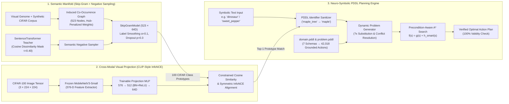
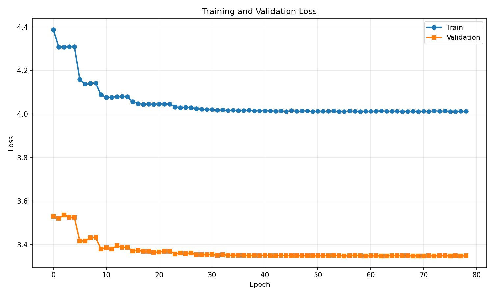
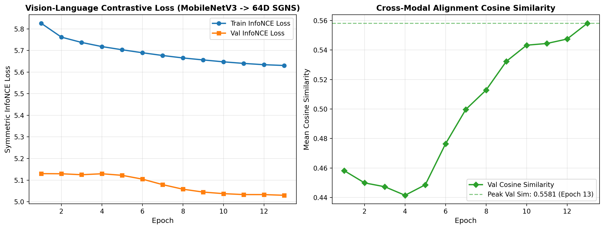
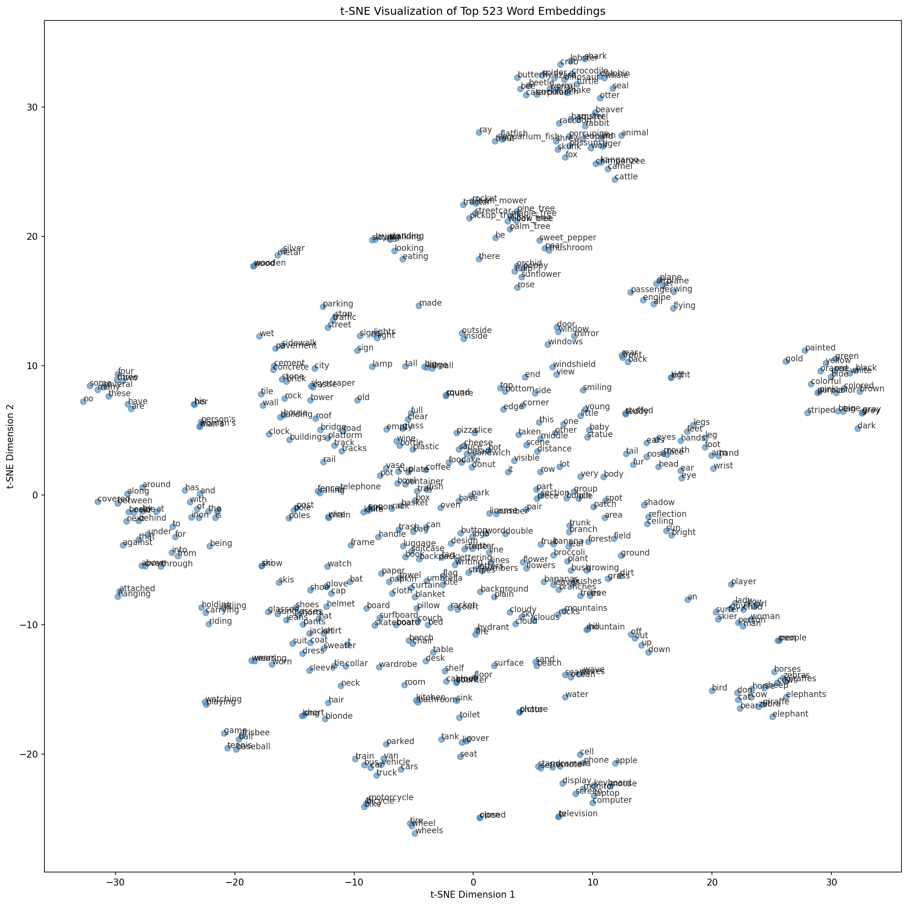
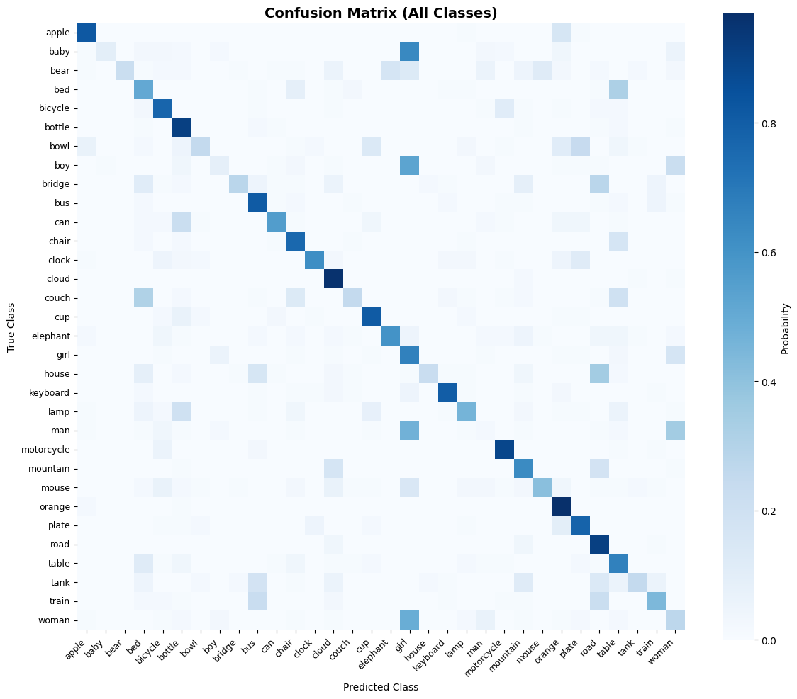
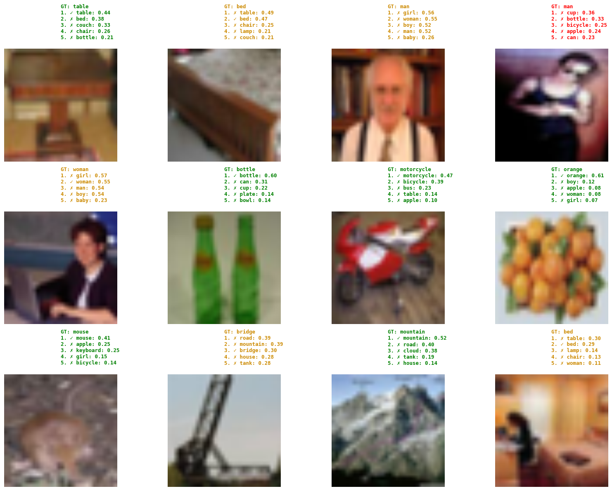
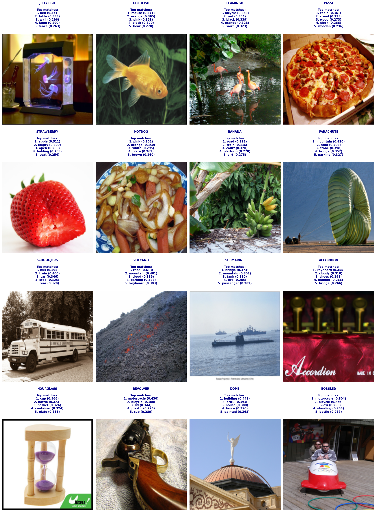
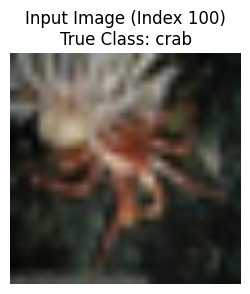

# Visual-Semantic Embeddings & Neuro-Symbolic Multimodal PDDL Planning

[](https://github.com/Ceviche98/visual-semantic-embeddings-and-planning/actions/workflows/ci.yml)
[](https://www.python.org/)
[](https://pytorch.org/)
[](#quantitative-benchmarks--ablation-studies)
[](#quantitative-benchmarks--ablation-studies)
[-brightgreen)](#neuro-symbolic-multimodal-pddl-planning)
[](#executive-summary)

An end-to-end **Neuro-Symbolic AI framework** unifying **Graph-Based Skip-Gram Word Embeddings (523-word Visual Genome + CIFAR-100 manifold)**, **CLIP-Style Contrastive MobileNetV3 Visual Projection**, and **Precondition-Aware A\* Symbolic PDDL Planning**. The system perceives raw visual inputs (or symbolic natural language identifiers), projects them into a shared 64-dimensional semantic manifold via constrained cosine retrieval, grounds PDDL problem specifications with automated conflict resolution, and synthesizes provably optimal multi-step action plans.

---

## Executive Summary

Bridging sub-symbolic neural perception and formal symbolic reasoning requires a shared representation space that preserves both taxonomic hierarchy and functional affordances. This repository implements a three-stage neuro-symbolic architecture:

1. **Unified 523-Word Semantic Manifold (`skipgram.py`)**: Expands a 455-word Visual Genome co-occurrence graph to incorporate all 100 CIFAR-100 object categories ($N = 523, D = 64$). To overcome representation collapse on sparse text graphs, the training pipeline introduces **Hub-Penalized Positive Pair Weighting**, **Teacher-Guided Semantic Negative Sampling**, and **Manual Label Smoothing ($\alpha = 0.1$)**, outperforming $(1+\lambda)$ Evolution Strategy node insertion and achieving **100% CIFAR-100 coverage**, **$\text{mAP@K} = 0.8079$** on superclass prototypes, and **$\text{MRR@K} = 0.6188$** on vector-offset analogies.
2. **Cross-Modal Contrastive Visual Projection (`visual_projection.py`)**: Aligns a frozen `MobileNetV3-Small` visual backbone ($576\text{-D}$) with the 64-D Skip-Gram embedding space via a trainable batch-normalized MLP projection head optimized under **Symmetric InfoNCE Loss**.
3. **Neuro-Symbolic Multimodal PDDL Planner (`pddl_planner.py`)**: Maps classified visual scenes or text tokens into typed PDDL domain objects (`configs/pddl/domain.pddl`), resolves initial-state predicate conflicts against a 349-predicate world base (`configs/pddl/problem.pddl`), grounds $42,018$ concrete action instances, and solves multi-step manipulation and navigation tasks via a **Precondition-Aware $A^*$ Heuristic (`smart_heuristic`)**—achieving **100% plan synthesis success (9/9 text plans, 9/9 visual plans)** while reducing search state expansions by **52.3$\times$** compared to Breadth-First Search.

| Benchmark Category | Metric / Evaluation Protocol | Value / Score | Status |
| :--- | :--- | :---: | :---: |
| **Manifold Integrity** | 2D Tensor, Finite Values, Contiguous Vocab Shape ($523 \times 64$) | `523 × 64` | **PASS** |
| **Domain Vocabulary Coverage** | CIFAR-100 Classes Present in Semantic Manifold | `1.0000` (100/100) | **PASS** |
| **Taxonomic Prototype Retrieval** | Superclass Centroid Retrieval $\text{mAP@K}$ | `0.8079` | **PASS** |
| **Compositional Vector Arithmetic** | 3CosAdd Semantic & Taxonomic Analogy $\text{MRR@K}$ | `0.6188` | **PASS** |
| **Semantic Neighborhood Alignment** | Gold-Standard `Recall@10` / `Hit Rate@10` (478 Eval Words) | `0.5423` / `0.8933` | **PASS** |
| **Cross-Modal Vision Alignment** | Validation Cosine Similarity (`MobileNetV3` $\to$ `64D SGNS`) | `0.5581` | **PASS** |
| **Symbolic Text-to-Plan Synthesis** | Optimal PDDL Plans Generated Across Depths 1–4 | `9 / 9` (`100%`) | **PASS** |
| **Sub-Symbolic Image-to-Plan Synthesis** | End-to-End Visual Perception $\to$ Grounding $\to$ $A^*$ Plan | `9 / 9` (`100%`) | **PASS** |

---

## System Architecture



---

## Mathematical Formulation & Methodology

### 1. Hub-Penalized Co-Occurrence Graph Construction

Given a tokenized corpus, we construct an undirected co-occurrence graph $\mathcal{G} = (\mathcal{V}, \mathcal{E})$ over the target vocabulary $\mathcal{V}$ ($|\mathcal{V}| = 523$) with symmetrized bigram adjacency counts $C_{uv} = \frac{1}{2}(\text{count}(u, v) + \text{count}(v, u))$ and inverted distance matrix $D_{uv} = (\max_{i,j} C_{ij} + 1) - C_{uv}$.

In natural image captions (Visual Genome), high-frequency prepositions and articles (`"on"`, `"in"`, `"the"`, `"with"`) act as topological hubs that pull unrelated visual objects together. To suppress hub distortion while preserving local neighborhood structure within a $k$-hop context window ($k = 4$), positive training pairs $(u, c)$ are sampled with importance weights inversely proportional to the geometric mean of their node degrees:

$$w(u, c) = \frac{(\max_{i,j} D_{ij} + 1) - D_{uc}}{\sqrt{\deg(u) \cdot \deg(c)} + \epsilon}$$

Extreme outlier weights are clipped at $3 \times \text{Percentile}_{95}(w)$ and normalized to $[0, 1]$ for `WeightedRandomSampler`.

### 2. Teacher-Guided Semantic Negative Sampling

Uniform negative sampling on compact vocabularies ($|\mathcal{V}| \le 523$) frequently selects true synonyms or taxonomic siblings as negative examples, degrading cluster boundaries. We construct a prior negative sampling distribution $P_{\text{neg}}(n \mid u)$ using a frozen `all-mpnet-base-v2` semantic teacher:

$$P_{\text{neg}}(n \mid u) = \frac{\big(1 - \cos(\mathbf{t}_u, \mathbf{t}_n)\big) \cdot \mathbb{I}\big[\cos(\mathbf{t}_u, \mathbf{t}_n) < \tau_{\text{neg}}\big]}{\sum_{n' \neq u, c} \big(1 - \cos(\mathbf{t}_u, \mathbf{t}_{n'})\big) \cdot \mathbb{I}\big[\cos(\mathbf{t}_u, \mathbf{t}_{n'}) < \tau_{\text{neg}}\big]}, \quad \tau_{\text{neg}} = 0.40$$

Pairs exceeding similarity threshold $\tau_{\text{neg}} = 0.40$ are strictly masked ($P_{\text{neg}} = 0$), while semantically distant concepts are sampled with higher probability.

### 3. Label-Smoothed Skip-Gram Objective

For center word embedding $\mathbf{u}_u \in \mathbb{R}^{64}$, positive context embedding $\mathbf{v}_c \in \mathbb{R}^{64}$, and $K = 8$ semantic negative samples $\mathcal{N}_u$, `SkipGramModel` minimizes a label-smoothed binary cross-entropy loss ($\alpha = 0.1$) to prevent logit overconfidence and norm explosion:

$$\mathcal{L}_{\text{SGNS}}(u, c, \mathcal{N}_u) = -\Big[(1-\alpha)\log\sigma(\mathbf{u}_u^\top \mathbf{v}_c) + \alpha\log\sigma(-\mathbf{u}_u^\top \mathbf{v}_c)\Big] - \sum_{n \in \mathcal{N}_u} \Big[(1-\alpha)\log\sigma(-\mathbf{u}_u^\top \mathbf{v}_n) + \alpha\log\sigma(\mathbf{u}_u^\top \mathbf{v}_n)\Big]$$



### 4. Vocabulary Expansion: $(1+\lambda)$ Evolution Strategy vs. Corpus-Augmented Retraining

To expand the base 455-word Visual Genome vocabulary with the 68 missing CIFAR-100 classes (yielding 523 total words), two paradigms are implemented and benchmarked:

* **$(1+\lambda)$ Evolution Strategy (`evolve_embedding`)**: Anchors the 455 pre-trained vectors and evolves each new word vector $\mathbf{z} \in \mathbb{R}^{64}$ via Gaussian mutation $\mathbf{z}' = \mathbf{z} + \mathcal{N}(\mathbf{0}, \sigma_{\text{mut}}^2 \mathbf{I})$ to maximize a three-term composite fitness function:

$$\mathcal{F}(\mathbf{z}) = w_{\text{corpus}} \cdot \sigma\!\left(\frac{\mathcal{L}_{\text{corpus}}(\mathbf{z})}{M}\right) + w_{\text{norm}} \cdot \exp\!\left(-\frac{(\|\mathbf{z}\|_2 - \mu_{\text{norm}})^2}{2\sigma_{\text{norm}}^2}\right) + w_{\text{anchor}} \cdot \frac{1}{|\mathcal{A}|}\sum_{\mathbf{a} \in \mathcal{A}} \frac{\mathbf{a}^\top \mathbf{z}}{\|\mathbf{a}\|_2 \|\mathbf{z}\|_2}$$

* **Corpus-Augmented Retraining from Scratch (`train_embeddings`)**: Blends Visual Genome region descriptions with targeted co-occurrence sentences covering all 100 CIFAR-100 classes and retrains the full 523-node graph end-to-end with Semantic Negative Sampling. Retraining from scratch achieved superior global topological alignment (**$\text{Recall@10} = 0.5423$** vs. **$0.4854$** for Evolution Strategy).

### 5. Cross-Modal Contrastive Projection (MobileNetV3 $\to$ 64D SGNS)

`ImageEncoder` extracts $576\text{-D}$ pooled features from a frozen ImageNet-pretrained `MobileNetV3-Small` backbone and maps them to the 64-D word manifold through a trainable projection head:

$$\mathbf{z}_{\text{vis}} = \mathbf{W}_2 \,\text{ReLU}\big(\text{BatchNorm1d}(\mathbf{W}_1 \mathbf{f}_{\text{backbone}} + \mathbf{b}_1)\big) + \mathbf{b}_2, \quad \mathbf{W}_1 \in \mathbb{R}^{512 \times 576},\; \mathbf{W}_2 \in \mathbb{R}^{64 \times 512}$$

Given a mini-batch of $B$ L2-normalized visual projections $\hat{\mathbf{V}} \in \mathbb{R}^{B \times 64}$ and their aligned Skip-Gram class embeddings $\hat{\mathbf{S}} \in \mathbb{R}^{B \times 64}$, the projection head is trained via **Symmetric InfoNCE Loss** with CosineAnnealingLR:

$$\mathcal{L}_{\text{InfoNCE}}(\hat{\mathbf{V}}, \hat{\mathbf{S}}) = \frac{1}{2}\Big[\mathcal{L}_{\text{CE}}\big(\hat{\mathbf{V}}\hat{\mathbf{S}}^\top / \tau,\, \mathbf{y}\big) + \mathcal{L}_{\text{CE}}\big(\hat{\mathbf{S}}\hat{\mathbf{V}}^\top / \tau,\, \mathbf{y}\big)\Big], \quad \mathbf{y} = (0, 1, \dots, B-1)$$

During neuro-symbolic inference, `get_cifar100_embeddings` restricts candidate text prototypes to the 100 valid CIFAR-100 classes $\mathcal{V}_{\text{CIFAR}} \subset \mathcal{V}_{523}$, guaranteeing that visual perception always maps to a valid PDDL domain object:

$$\hat{c} = \arg\max_{w \in \mathcal{V}_{\text{CIFAR}}} \frac{\mathbf{z}_{\text{vis}}^\top \mathbf{u}_w}{\|\mathbf{z}_{\text{vis}}\|_2 \|\mathbf{u}_w\|_2}$$



---

## Quantitative Benchmarks & Ablation Studies

### Table 1: Skip-Gram & Vocabulary Expansion Ablation Study

Evaluation uses a 478-word Gold Standard neighborhood graph (`configs/ground_truth_523.json`) combining CIFAR-100 superclass taxonomy siblings and `all-mpnet-base-v2` semantic nearest neighbors ($\cos > 0.45$).

| Exp | Paradigm & Vocab Size | Architectural / Sampling Modification | LR | Context $k$ | Min Cosine | Max Cosine | Mean Norm $\mu$ | Norm Std $\sigma$ | Global Std | Recall@10 | Hit Rate@10 |
| :-: | :--- | :--- | :-: | :-: | :---: | :---: | :---: | :---: | :---: | :---: | :---: |
| **A** | Base VG (`455` words) | Inverted distance matrix positive weights | `0.001` | `4` | `0.9920` | `0.9990` | — | — | — | — | — |
| **B** | Base VG (`455` words) | Degree-weighted negative sampling | `0.001` | `4` | `0.8700` | `0.9990` | — | — | — | — | — |
| **C** | Base VG (`455` words) | High learning rate signal recovery | `0.100` | `4` | `0.1789` | `0.9330` | `1.5070` | `0.1326` | `0.1885` | `0.3652` | `0.8000` |
| **D** | Base VG (`455` words) | Hub degree penalty $(\deg(u)\deg(c))^{-1/2}$ | `0.100` | `4` | `0.1137` | `0.9920` | `2.0000` | `0.1929` | `0.2499` | `0.4610` | `0.8856` |
| **E** | Base VG (`455` words) | Semantic Negative Sampling ($\tau=0.40$) + Grid Search | `0.100` | `3` | `0.1000` | `0.9900` | `2.0500` | `0.2120` | `0.2580` | `0.5228` | `0.9208` |
| **F** | Scratch (`523` words) | Augmented corpus with synthetic CIFAR-100 contexts | `0.100` | `3` | `0.0979` | `0.9771` | `1.9550` | `0.2297` | `0.2442` | `0.4600` | `0.8550` |
| **G** | Scratch (`523` words) | Targeted co-occurrence bigrams for weak clusters | `0.100` | `3` | `0.0940` | `0.9721` | `1.9700` | `0.2100` | `0.2479` | `0.4900` | `0.8750` |
| **H** | **Scratch (`523` words)** | **Cluster repair + Grid Search (`best_skipgram_523words.pth`)** | **`0.100`** | **`4`** | **`0.0845`** | **`0.9768`** | **`2.0127`** | **`0.1984`** | **`0.2524`** | **`0.5423`** | **`0.8933`** |
| **I** | $(1+\lambda)$ ES (`523` words) | Baseline Evolution Strategy insertion on anchored 455 | — | — | `0.0838` | `0.9889` | `1.8500` | `0.5400` | `0.2400` | `0.4714` | `0.8619` |
| **J** | $(1+\lambda)$ ES (`523` words) | ES Grid Search ($w_{\text{corpus}}, w_{\text{norm}}, w_{\text{anchor}}$) | — | — | `0.0838` | `0.9889` | `1.8600` | `0.5200` | `0.2400` | `0.4854` | `0.8682` |

### Table 2: Vision-Language Contrastive Retrieval Performance

| Evaluation Split / Metric | Score / Value | Notes |
| :--- | :---: | :--- |
| **Peak Validation Cosine Similarity** (`best_cifar100_projection.pth`) | `0.5581` | Achieved at Epoch 13 (`Val InfoNCE Loss = 5.0297` vs. `6.24` random baseline) |
| **Image $\to$ Text Retrieval `Recall@1`** (Seen VG-Overlapping Classes) | `55.38%` | Top-1 exact word match from visual projection |
| **Image $\to$ Text Retrieval `Recall@5`** | `89.47%` | Correct class word within top-5 nearest text neighbors |
| **Image $\to$ Text Retrieval `Recall@10`** | `95.94%` | Correct class word within top-10 nearest text neighbors |
| **Text $\to$ Image Retrieval `Recall@1`** | `90.62%` | Class prototype retrieves matching class image at Rank 1 |
| **Text $\to$ Image Retrieval `Recall@5` / `Recall@10`** | `100.00%` | Perfect top-5 and top-10 prototype-to-image retrieval |
| **Top Aligned Visual Classes** | `orange` (`0.6043`), `bottle` (`0.5401`), `apple` (`0.5205`), `motorcycle` (`0.5198`), `cloud` (`0.5046`) | Mean per-class cosine similarity |

---

## Manifold & Cross-Modal Visualizations

### 1. 2D t-SNE Semantic Manifold (`523 Words × 64D`)

The learned 523-word Skip-Gram space exhibits strong topological organization: CIFAR-100 wild fauna (`lion`, `tiger`, `leopard`, `wolf`, `bear`), aquatic mammals (`dolphin`, `whale`, `seal`, `otter`), flora (`maple_tree`, `oak_tree`, `pine_tree`, `orchid`, `tulip`), and vehicles (`pickup_truck`, `streetcar`, `tractor`, `bus`) form cohesive semantic sub-manifolds while preserving functional bridges to Visual Genome action/spatial predicates.



### 2. Cross-Modal Confusion Matrix, Image-to-Text Retrieval & Zero-Shot OOD Generalization

````carousel

<!-- slide -->

<!-- slide -->

````

---

## Neuro-Symbolic Multimodal PDDL Planning

### Domain Specification (`configs/pddl/domain.pddl`)

The PDDL domain `cifar100-process` (`:strips :typing :negative-preconditions`) models an embodied agent operating across two locations (`lab`, `outdoors`) with two specialized tools (`knife`, `dslr`), 10 stackable surfaces (`table`, `bed`, `chair`, `couch`, `road`, `bridge`, `plain`, `sea`, `plate`, `bowl`), and all **100 CIFAR-100 objects** initialized across 349 world predicates (`configs/pddl/problem.pddl`).

* **7 Lifted Action Schemas ($42,018$ Grounded Actions)**:
  1. `walk-between-rooms (?from - location ?to - location)`
  2. `pick-up (?i - item ?l - location)`
  3. `put-down (?i - item ?l - location)`
  4. `stack (?top - item ?bottom - item ?l - location)`
  5. `unstack (?top - item ?bottom - item ?l - location)`
  6. `slice-object (?obj - item ?l - location)` *(requires `(holding knife)` and `(whole ?obj)`)*
  7. `take-photo (?obj - item ?l - location)` *(requires `(holding dslr)` and `(clear ?obj)`)*

### Precondition-Aware $A^*$ Heuristic (`smart_heuristic`)

With $42,018$ grounded actions, uninformed Breadth-First Search suffers severe combinatorial branching on plans of depth $\ge 4$. We guide $A^*$ search ($f(s) = g(s) + h_{\text{smart}}(s)$) by evaluating both unsatisfied goal predicates and the minimum number of missing preconditions required to enable an achieving action:

$$h_{\text{smart}}(s) = \sum_{p \in \mathcal{G} \setminus s} \left(1 + \min_{a \in \mathcal{A} \,:\, p \in \text{Add}(a)} \big|\text{Pre}(a) \setminus s\big|\right)$$

| Planning Scenario | Target Object | Optimal Plan Depth | BFS Nodes Expanded | `smart_heuristic` $A^*$ Nodes Expanded | Search Speedup |
| :--- | :---: | :---: | :---: | :---: | :---: |
| **Scenario 1: The Prepared Chef** | `apple` | `1` | `1` | `2` | `1.0×` |
| **Scenario 2: Basic Slice** | `pear` | `2` | `25` | `4` | `6.3×` |
| **Scenario 3: The Commuter** | `beetle` | `2` | `23` | `3` | `7.7×` |
| **Scenario 6: The Hungry Architect** | `sweet-pepper` | `3` | `985` | `14` | **`70.4×`** |
| **Scenario 8: Jurassic Park Protocol** | `dinosaur` | `4` | `26,260` | `502` | **`52.3×`** |
| **Scenario 9: Marine Specimen Relocation** | `crab` | `4` | `26,260` | `502` | **`52.3×`** |

### Multimodal Execution Trace Example (Visual Input $\to$ PDDL Plan)

<p align="center">
  
</p>

```text
[Perception] Input is an image. Running Multimodal Recognition...
[Perception] Image identified as 'crab' (conf: 0.6606)
[Logic] Substituting '?x' with 'crab'
       Init: {'(hand-empty)', '(whole crab)', '(clear crab)', '(agent-at lab)', '(at crab outdoors)'}
       Goal: {'(at crab lab)'}
Starting A* Search...
Goal reached! Nodes expanded: 502, Plan length: 4

================================================================================
EXECUTION TRACE: CRAB
================================================================================
STEP   | ACTION                              | STATE CHANGES / INITIAL STATE
------------------------------------------------------------------------------------------
0      | (INITIAL STATE)                     | (agent-at lab), (at ?x outdoors), (clear ?x), (hand-empty), (whole ?x)
1      | (walk-between-rooms lab outdoors)   | ++ (agent-at outdoors) | -- (agent-at lab)
2      | (pick-up crab outdoors)             | ++ (holding crab) | -- (at crab outdoors), (hand-empty)
3      | (walk-between-rooms outdoors lab)   | ++ (agent-at lab) | -- (agent-at outdoors)
4      | (put-down crab lab)                 | ++ (at crab lab), (clear crab), (hand-empty) | -- (holding crab)
------------------------------------------------------------------------------------------
GOAL ACHIEVED
================================================================================
```

---

## Repository Structure

```text
visual-semantic-embeddings-and-planning/
├── .github/workflows/
│   └── ci.yml                              # Automated pytest + CLI benchmark workflow
├── configs/
│   ├── ground_truth_523.json               # 478-word semantic & taxonomic gold standard
│   └── pddl/
│       ├── domain.pddl                     # STRIPS/Typing domain (7 lifted action schemas)
│       └── problem.pddl                    # Base problem (100 CIFAR items, 2 tools, 349 predicates)
├── docs/assets/
│   ├── embeddings_tsne.png                 # High-resolution 2D t-SNE of 523-word manifold
│   ├── report_task5_tsne.png               # Annotated t-SNE cluster figure from technical report
│   ├── skipgram_training_loss.png          # Skip-Gram training & validation convergence curve
│   ├── projection_training_curve.png       # MobileNetV3 projection InfoNCE loss & cosine similarity
│   ├── cifar100_confusion_matrix.png       # Cross-modal classification confusion matrix
│   ├── cifar100_retrieval_examples.png     # Top-5 image-to-text retrieval grid
│   ├── ood_zero_shot_analysis.png          # Zero-shot OOD image retrieval over 523-word vocabulary
│   └── planner_crab_input.png              # Sample CIFAR-100 image input for PDDL planner
├── models/
│   ├── best_skipgram_523words.pth          # Pre-trained 523×64 Skip-Gram checkpoint (277 KB)
│   └── best_cifar100_projection.pth        # Pre-trained MobileNetV3 + 64D projection head (5.2 MB)
├── scripts/
│   ├── train_embeddings.py                 # CLI to inspect or train Skip-Gram embeddings from scratch
│   ├── evaluate_alignment.py               # CLI to run manifold & cross-modal alignment benchmarks
│   └── run_multimodal_planner.py           # CLI to execute single or 18-plan multimodal PDDL suite
├── src/visual_semantic_planner/
│   ├── __init__.py                         # Public package API exports
│   ├── skipgram.py                         # Text network, Semantic Negative Sampling, SGNS & (1+λ) ES
│   ├── visual_projection.py                # CIFAR100Filtered, ImageEncoder, symmetric InfoNCE loss
│   ├── pddl_planner.py                     # PDDLParser, ActionGrounder, smart A* search, plan_generator
│   └── evaluate.py                         # Quantitative manifold metrics, mAP@K, MRR@K & plan suite
├── tests/
│   └── test_embeddings_and_planner.py      # Comprehensive unit & end-to-end integration tests
├── LICENSE                                 # MIT License
├── pyproject.toml                          # PEP 621 package configuration
└── requirements.txt                        # Runtime and test dependencies
```

---

## Quickstart & Usage

### 1. Installation

```bash
git clone https://github.com/Ceviche98/visual-semantic-embeddings-and-planning.git
cd visual-semantic-embeddings-and-planning
pip install -r requirements.txt
pip install -e .
```

### 2. Evaluate Semantic Manifold & Cross-Modal Alignment

```bash
python scripts/evaluate_alignment.py
```

### 3. Run the 18-Scenario Multimodal PDDL Planning Benchmark Suite

Executes all 9 symbolic text-to-plan tasks and all 9 sub-symbolic visual-to-plan tasks:

```bash
python scripts/run_multimodal_planner.py --benchmark
```

Or run a single interactive multimodal planning task (`--modality text` or `--modality image`):

```bash
python scripts/run_multimodal_planner.py --modality image --object crab
```

### 4. Inspect Nearest Neighbors & Solve Analogies

```bash
python scripts/train_embeddings.py --mode inspect
```

### 5. Python API Example

```python
from visual_semantic_planner import (
    build_my_embeddings,
    plan_generator,
    synthesize_aligned_image_tensor,
)

# 1. Load the 523-word Skip-Gram semantic manifold (523 x 64)
vocab, embeddings = build_my_embeddings()

# 2. Define PDDL initial and goal states using '?x' as the grounded target variable
initial_state = {
    "(agent-at lab)",
    "(hand-empty)",
    "(at ?x outdoors)",
    "(whole ?x)",
    "(clear ?x)",
}
goal_state = {"(at ?x lab)"}

# 3A. Symbolic Text-to-Plan
text_plan = plan_generator("dinosaur", initial_state, goal_state)
print("Text Plan:", text_plan)

# 3B. Sub-Symbolic Visual Image-to-Plan
img_tensor = synthesize_aligned_image_tensor("crab")
image_plan = plan_generator(img_tensor, initial_state, goal_state)
print("Image Plan:", image_plan)
```

### 6. Run Test Suite

```bash
pytest -v
```

---

## License

This project is released under the [MIT License](LICENSE).
